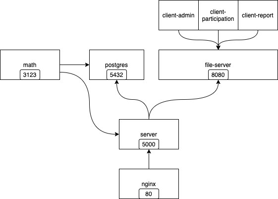

# Architecture

## Components

The diagram is PolisOrbis's own Docker layout. In this kit the `nginx` box is **not** the upstream `nginx-proxy`: it is the host's
nginx (production) or nothing (local), and the server listens on `127.0.0.1:8192` (prod) or `8190` (local).

| Component | Technology | Role |
|---|---|---|
| `server` | Node, TypeScript (`server/`) | The API on port 5000 and the entry point. Also proxies the web clients from `file-server`. Holds the organizer and participant logic, the fork's routes, the optional prune cron. |
| `math` | Clojure (`math/`), port 3123 | Computes the opinion groups and consensus statistics from the votes. |
| `postgres` | PostgreSQL, Copernicani's published image | All persistent data. Volumes `postgres` (data) and `backups`. |
| `file-server` | Node (`file-server/`), port 8080 | Serves the three built web clients. Built with the branding values. |
| clients | `client-participation`, `client-admin`, `client-report` | The voting page; the organizer pages, home page and legal pages; the report. |

## How a request flows

* A browser opens `https://polis.example.org/<id>`. The host nginx proxies to the server on `127.0.0.1:8192`; the server serves the
  voting page's assets from `file-server`.
* The voting page calls `/api/v3/...` on the same host. A vote or a statement is written to Postgres by the server.
* The `math` service computes the opinion groups and consensus from the votes; in the diagram it is connected to Postgres and to the server. The report page is another client of the same API.
* The nginx site refuses `POST /api/v3/auth/new` and `/api/v3/prune` and redirects `/createuser`; everything else, including
  `/api/v3/citizens/*`, passes.
* A Citizens installation calls `POST /api/v3/citizens/import` over HTTPS with a Bearer key; see [Contract](../bridge/contract.md).

The sources do not describe the maths-to-server exchange in more detail, so this page does not.

## Where things live in the repository

| Path | Contents |
|---|---|
| `server/` | API server. `app.ts` holds the route table; `src/routes/` the fork's handlers (`citizensImport.ts`, `citizensPing.ts`, `commentsBulk.ts`, `aiDraft.ts`, `listedConversations.ts`); `src/utils/` helpers (`citizensImport.ts` validation and the personal-data guard, `seedCsv.ts`, `aiDraft.ts`, `rateLimit.ts`); `startup.sh` the optional prune cron |
| `math/` | The maths (Clojure) |
| `client-participation/` | The voting page |
| `client-admin/` | Organizer pages, home page, legal pages (`src/content/privacy*.md`, `tos*.md`) |
| `client-report/` | The report |
| `file-server/` | Serves the three clients |
| `deploy/` | `polis.sh`, `build-images.sh`, `branding.env`, `local/` and `prod/` overrides, the nginx site, account and key scripts, `sql/` and `migrate.sh` |
| `docs/` | `production.md`, `citizens-integration.md`, `decisions.md`, `branding.md`, `host.md` |
| `CHANGELOG.md` | Newest first; the PolisOrbis changelog follows a separator |

Some fork modules live outside `server.ts` because that module shadows the global `Promise` with bluebird, which TypeScript refuses
next to an async function.

## Design tokens

Colours and fonts live in three files that must be kept in step; change them together to rebrand an installation. From
`docs/branding.md`:

| Token | Value | client-admin `src/theme/index.js` | client-participation `css/polis/base/_variables.scss` | client-report `src/components/globals.js` |
|---|---|---|---|---|
| primary | `#1d4ed8` | `colors.primary` | `$brand-color`, `$brand-text-color` | `brandColors.blue`, `brandColors.comment` |
| primary, hover | `#1e40af` | `colors.primaryDark` | `$hover-color`, `$btn-hover-color` | |
| accent (focus ring) | `#c2410c` | `colors.accent` | `$accent` | |
| ink (text) | `#0f172a` | `colors.text` | `$ink` | |
| muted text | `#475569` | `colors.muted` | `$muted` | `brandColors.mediumGrey` |
| page background | `#fffdf8` / `#f7f7f3` | `colors.background` | `$page-bg` | |
| surface, border | `#ffffff`, `#e2e8f0` | `colors.surface`, `colors.border` | `$surface`, `$border` | |
| agree / disagree | `#2ecc71` / `#e74c3c` | `colors.agree/disagree` | `$color_agree`, `$color_disagree` (+ tinted button pairs) | `brandColors.agree/disagree` |
| radius | 8px | `radii.default` | `$radius` | |

Fonts: Space Grotesk 400/600 (UI and body) and Fraunces 600 (landing heading), self-hosted under
`client-admin/public/fonts/brand/` and served at `/fonts/brand/` for every client; declared in `client-admin/public/index.ejs`,
`client-participation/css/polis_main.scss` and `client-report/src/index.css`.

The report has its own CSS variables in `client-report/src/report.css`: `--primary`, `--ink`, `--muted`, `--bg`, `--surface`,
`--line`, `--accent`, and the vote colours `--agree #15803d`, `--disagree #b91c1c`, `--pass #cbd5e1`, `--novote #f1f5f9`. The
colour-blind switch (`.report--cb`) swaps agree and disagree to `#1d4ed8` and `#c2410c`. Opinion-group colours for the map stay in
`src/components/globals.js`.

## Phone layout

The same markup serves every layout. On a phone (body up to 600 px, not in an iframe) `participation.js` sets `body.appMode` and
the current pane in `data-pane`; the rest is CSS.
